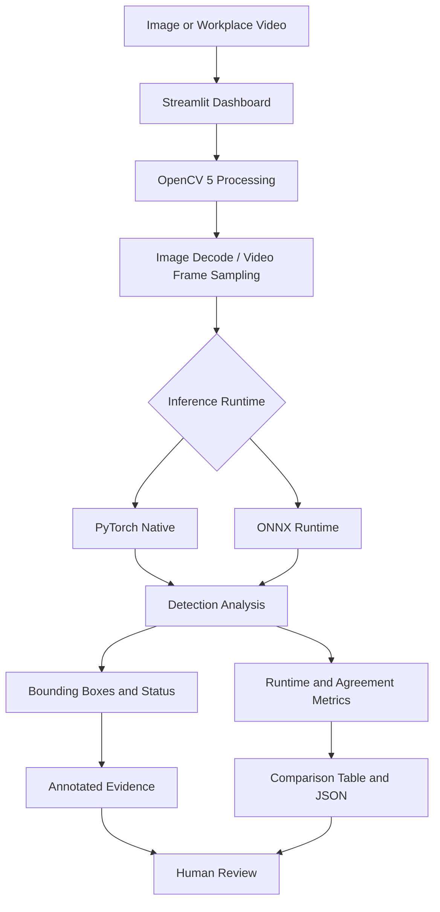

# 🛡️ VisionGuard AI — GPU-Accelerated PPE Inspection & Inference Optimization

**OpenCV AI Competition 2026 · Powered by AWS**

VisionGuard AI is a computer-vision research prototype for workplace Personal Protective Equipment (PPE) inspection. It analyzes images and sampled video frames to identify helmet-like objects and heads, presents annotated visual evidence, and flags potentially concerning results for human review.

The project combines **OpenCV 5, YOLO-based detection, PyTorch CUDA inference, ONNX Runtime, and an interactive Streamlit dashboard**. Its inference laboratory compares runtime latency and detection agreement to explore performance optimization and the potential to reduce compute costs.

<p align="center">

  <a href="https://visionguard-ai-latest.onrender.com/"><strong>🚀 Live Demo</strong></a> ·
  <a href="https://github.com/GouravGC/VisionGuard-AI"><strong>💻 Source Code</strong></a> ·
  <a href="https://github.com/GouravGC/VisionGuard-AI/actions"><strong>⚙️ CI/CD</strong></a> ·
  <a href="https://opencv26.devpost.com/"><strong>🏆 Competition</strong></a>

</p>

> **Responsible-use notice:** VisionGuard AI is an experimental research prototype, not a certified occupational-safety system. Detection results can be incorrect or incomplete. Human verification is required.

## 📌 Project at a glance

| Area | Implementation |
|---|---|
| Problem domain | Workplace PPE visual inspection |
| Image and video processing | OpenCV 5 |
| Object detection | Fine-tuned YOLOv8 nano model |
| Model formats | PyTorch `.pt` and ONNX `.onnx` |
| GPU inference | PyTorch with CUDA |
| Alternative inference | ONNX Runtime |
| Interactive interface | Streamlit |
| Video processing | Configurable frame sampling |
| Performance evaluation | Latency and detection-agreement comparison |
| Testing | Pytest |
| Automation | GitHub Actions |
| Containerization | Docker |
| Hosting | Render |
| Planned extension | AWS-backed inspection evidence and serverless processing |

## 🔗 Project links

| Resource | Link |
|---|---|
| Live application | [Open VisionGuard AI](https://visionguard-ai-latest.onrender.com/) |
| GitHub repository | [GouravGC/VisionGuard-AI](https://github.com/GouravGC/VisionGuard-AI) |
| GitHub Actions | [CI/CD workflow runs](https://github.com/GouravGC/VisionGuard-AI/actions) |
| Container package | [VisionGuard AI on GHCR](https://github.com/GouravGC/VisionGuard-AI/pkgs/container/visionguard-ai) |
| Architecture documentation | [docs/architecture.md](https://github.com/GouravGC/VisionGuard-AI/blob/main/docs/architecture.md) |
| Model card and validation metrics | [docs/model-card.md](https://github.com/GouravGC/VisionGuard-AI/blob/main/docs/model-card.md) |
| Dependencies | [requirements.txt](https://github.com/GouravGC/VisionGuard-AI/blob/main/requirements.txt) |
| Application entry point | [app.py](https://github.com/GouravGC/VisionGuard-AI/blob/main/app.py) |
| Automated tests | [tests/](https://github.com/GouravGC/VisionGuard-AI/tree/main/tests) |
| OpenCV AI Competition | [Competition page](https://opencv26.devpost.com/) |
| Competition rules and submission requirements | [Official rules](https://opencv26.devpost.com/rules) |

## ✨ Key features

- **Image inspection:** Upload a workplace image and inspect model detections.
- **Video inspection:** Analyze sampled frames from uploaded videos.
- **Dual-runtime inference:** Compare PyTorch Native with ONNX Runtime.
- **GPU acceleration:** Use an NVIDIA CUDA-capable GPU for PyTorch inference when available.
- **Latency comparison:** View observed detector-call timings for both runtimes.
- **Detection agreement:** Compare bounding-box matches using an Intersection over Union (IoU) threshold.
- **Configurable inference:** Adjust confidence threshold, image size, video frame interval, and maximum sampled frames.
- **Annotated evidence:** View detection overlays and inspection summaries.
- **Downloadable results:** Export supported inspection reports, including JSON comparison data.
- **Human-review flags:** Surface potentially concerning or inconclusive findings without making definitive compliance decisions.
- **Reproducible engineering:** Repository includes tests, dependency pins, Docker configuration, and GitHub Actions automation.

## 🏗️ Architecture



### Processing workflow

1. The user uploads an image or video through Streamlit.
2. OpenCV decodes the input and samples video frames according to the configured interval.
3. The selected inference runtime executes the trained detection model.
4. The analysis layer summarizes helmet/head detections and uncertainty.
5. The application compares runtime results when comparison mode is selected.
6. Annotated images, detection summaries, timings, and downloadable results are presented for human review.

The application can flag frames for review when visual evidence raises a potential concern. It is a prototype workflow, not an autonomous safety agent that independently dispatches personnel or makes final compliance decisions.

For the implementation details, see the [architecture document](https://github.com/GouravGC/VisionGuard-AI/blob/main/docs/architecture.md).

## ⚡ GPU inference and ONNX optimization

The inference laboratory allows users to compare two execution paths using the same sampled video frames.

### Observed local hardware and configuration

| Setting | Observed value |
|---|---|
| GPU | NVIDIA GeForce RTX 3060, 12 GB VRAM |
| PyTorch execution provider | CUDA |
| ONNX Runtime execution provider | CPU |
| Confidence threshold | 0.35 |
| Input image size | 416 |
| Video frame interval | Every 15 frames |
| Maximum sampled frames | 30 |
| Video analyzed | 4K, 50 FPS MP4 sample |
| Sampled frames processed | 27 |

### Captured first-frame benchmark

The following values come from the local application screenshot and describe one displayed comparison.

| Metric | PyTorch Native | ONNX Runtime |
|---|---:|---:|
| Execution provider | CUDA GPU | CPU |
| Detector-call time | 62.50 ms | 23.01 ms |
| Helmet detections | 1 | 1 |
| Head detections | 0 | 0 |
| Detection status | `HELMET_DETECTED` | `HELMET_DETECTED` |

The application reported:

- Matched boxes: **1**
- PyTorch detections: **1**
- ONNX detections: **1**
- Detection agreement: **100%**
- IoU matching threshold: **0.5**
- Displayed speed ratio: **2.72× in favor of ONNX Runtime** for this first-frame measurement

These figures describe the captured example, not a universal performance guarantee. In particular, the 2.72× figure should not be interpreted as a statistically established speedup across all frames or workloads.

### What this means for optimization

The result motivates testing whether ONNX Runtime can deliver suitable performance on CPU hardware for selected inspection workloads.

Potential advantages, if further benchmarking confirms them, include:

- Reducing the need for GPU-backed infrastructure for suitable workloads.
- Lowering resource allocation for intermittent image inspections.
- Improving deployment flexibility where CPU inference meets latency requirements.
- Reducing compute cost per processed frame when measured hosting costs support that conclusion.

CPU inference will not necessarily outperform GPU inference for every model, workload, batch size, or environment. Execution providers, model initialization, preprocessing, memory use, concurrency, and hardware all affect the outcome.

### Benchmarking methodology

For a fair comparison, run repeated warmed-up measurements with identical input frames and report:

- Median and p95 inference latency.
- Frames processed per second.
- Detection agreement and ground-truth accuracy metrics.
- CPU/GPU utilization and memory usage.
- Compute cost per 1,000 processed frames.

The current detector-call timing can include initialization or warm-up effects. Detection agreement is not equivalent to accuracy; precision and recall require labeled ground-truth data.

## 💰 Cost-optimization strategy

VisionGuard AI explores cost optimization by evaluating the trade-off between inference speed, compute requirements, and detection quality.

### Optimization opportunities

**1. Runtime selection**

Evaluate PyTorch CUDA and ONNX CPU execution under representative workloads, then choose the least expensive configuration that meets the required latency and quality targets.

**2. Video frame sampling**

The current workflow samples every 15 frames and caps processing at 30 sampled frames per video. Sampling reduces the number of inference calls compared with processing every frame, but may miss short-lived events between sampled frames.

**3. Resource-aware deployment**

Intermittent image workloads may be suitable for CPU-based inference, while high-throughput or latency-sensitive workloads may justify GPU allocation. The choice should be based on measured throughput and deployment costs.

**4. Cost-per-frame measurement**

A consistent evaluation can calculate:

\[
\text{Cost per 1,000 frames} =
\frac{\text{Inference infrastructure cost}}{\text{Frames processed}}
\times 1{,}000
\]

This calculation requires actual infrastructure costs and processed-frame counts for the same measurement period.

**Important:** The current project has measured local runtime timings, not verified monetary savings. No percentage cost reduction is claimed.

## 🧠 Model and validation results

The model card records a YOLOv8 nano model initialized from pretrained weights and fine-tuned for 10 epochs on a Tesla T4 GPU, using an input size of 416 pixels.

The reported validation metrics are:

| Class | Precision | Recall | mAP50 | mAP50–95 |
|---|---:|---:|---:|---:|
| Helmet | 0.928 | 0.855 | 0.928 | 0.597 |
| Head | 0.901 | 0.838 | 0.904 | 0.581 |
| Person | 1.000 | 0.000 | 0.024 | 0.013 |
| Overall | 0.943 | 0.564 | 0.619 | 0.397 |

Source: [VisionGuard AI model card](https://github.com/GouravGC/VisionGuard-AI/blob/main/docs/model-card.md).

These are recorded validation results, not a guarantee of performance on new environments. The person class is excluded from the application's analysis because its validation performance was poor.

### Dataset and provenance

The model card identifies the [Hard Hat Detection dataset](https://universe.roboflow.com/) and reports the dataset source's CC0-1.0 designation. Verify the exact original dataset page, license, and attribution requirements before redistributing data or model artifacts.

## 🧰 Technology stack

| Technology | Role |
|---|---|
| [OpenCV](https://opencv.org/) | Image/video processing and visual annotations |
| [Ultralytics YOLO](https://docs.ultralytics.com/) | Object detection |
| [PyTorch](https://pytorch.org/) | Native model inference and CUDA acceleration |
| [ONNX](https://onnx.ai/) | Portable model representation |
| [ONNX Runtime](https://onnxruntime.ai/) | Alternative inference execution |
| [Streamlit](https://streamlit.io/) | Interactive dashboard |
| [NumPy](https://numpy.org/) | Numerical operations |
| [Pytest](https://docs.pytest.org/) | Automated testing |
| [GitHub Actions](https://github.com/features/actions) | Continuous integration |
| [Docker](https://www.docker.com/) | Containerization |
| [Render](https://render.com/) | Application hosting |

The exact pinned package versions are maintained in the repository's [`requirements.txt`](https://github.com/GouravGC/VisionGuard-AI/blob/main/requirements.txt).

## 🚀 Run locally

### Prerequisites

- Python 3.11
- Git
- The repository's pinned dependencies
- The trained model artifacts required by the selected inference runtime
- A compatible NVIDIA GPU and CUDA-enabled PyTorch build for GPU acceleration; CPU execution may be used where supported

### Installation

```bash
git clone https://github.com/GouravGC/VisionGuard-AI.git
cd VisionGuard-AI

python -m pip install -r requirements.txt
python -m pytest -q

streamlit run app.py
```

Open the local URL printed by Streamlit.

### Model files

The repository expects the trained model artifacts at:

```text
artifacts/
└── models/
    ├── visionguard_helmet.pt
    └── visionguard_helmet.onnx
```

The PyTorch model can alternatively be configured using `VISIONGUARD_MODEL_PATH`, as documented in the repository.

Use the model artifacts provided with the project. If model files are not included in a particular checkout, obtain them from the authorized project source before running inference.

## 🧪 Testing and delivery

The repository includes:

- Automated tests under [`tests/`](https://github.com/GouravGC/VisionGuard-AI/tree/main/tests).
- GitHub Actions workflow configuration under [`.github/workflows/`](https://github.com/GouravGC/VisionGuard-AI/tree/main/.github/workflows).
- A [`Dockerfile`](https://github.com/GouravGC/VisionGuard-AI/blob/main/Dockerfile).
- A [Render deployment blueprint](https://github.com/GouravGC/VisionGuard-AI/blob/main/render.yaml).
- Pinned dependencies in [`requirements.txt`](https://github.com/GouravGC/VisionGuard-AI/blob/main/requirements.txt).

View the [GitHub Actions run history](https://github.com/GouravGC/VisionGuard-AI/actions) for the recorded CI status.

## ☁️ AWS integration status

**AWS integration is a planned extension, not a completed or verified feature in this version.**

A potential extension is to store inspection metadata, JSON reports, and selected annotated evidence in a private Amazon S3 bucket, with an optional serverless workflow to evaluate high-risk inspection events.

That extension would require an activated AWS account, the necessary permissions, service access, and a successful end-to-end test. This repository does not claim that live S3, Lambda, Bedrock, or other AWS-backed processing is currently integrated.

The competition requires a meaningful component to run on AWS. See the [official competition rules](https://opencv26.devpost.com/rules) and ensure the final submission accurately describes the services actually implemented and demonstrated.

## ⚠️ Limitations and responsible use

- The application analyzes sampled frames rather than every video frame.
- Events occurring between sampled frames may be missed.
- False positives and false negatives are possible.
- The person class is excluded because of poor validation performance.
- Scene-level head and helmet detections do not associate a helmet with a specific worker.
- A helmet-like detection does not establish correct fit, wearing position, or individual compliance.
- Agreement between inference runtimes does not prove model accuracy.
- Benchmark results from one video and one machine may not generalize.
- No monetary cost savings have been verified.
- No live AWS integration is claimed in the current version.

**Human review is required.** The absence of detections must never be interpreted as proof that a scene is safe.

## 🔭 Future work

- Repeatable CPU-versus-GPU benchmarking with warm-up and percentile latency.
- Accuracy evaluation against labeled test data.
- Measurement of compute cost per 1,000 frames.
- Improved video sampling strategies and temporal consistency checks.
- Optional private AWS storage for inspection reports, subject to account and service availability.
- Optional serverless risk-event processing and operational monitoring.
- More extensive failure-case evaluation and reproducible deployment documentation.

## 🏆 Competition

Built for the **[OpenCV AI Competition 2026, powered by AWS](https://opencv26.devpost.com/)**.

The competition emphasizes practical computer-vision applications, technical execution, real-world impact, reproducibility, documentation, and responsible operation. See the [official rules and final submission requirements](https://opencv26.devpost.com/rules).

## 📄 License

See the repository's [`LICENSE`](https://github.com/GouravGC/VisionGuard-AI/blob/main/LICENSE) file for the project's licensing terms. Dataset and model-artifact terms may be separate.

---

<p align="center">

**VisionGuard AI**  
*Computer vision for PPE inspection. Measured inference performance. Human-in-the-loop review.*

[Live Demo](https://visionguard-ai-latest.onrender.com/) · [GitHub](https://github.com/GouravGC/VisionGuard-AI) · [CI/CD](https://github.com/GouravGC/VisionGuard-AI/actions) · [Competition](https://opencv26.devpost.com/)

</p>
